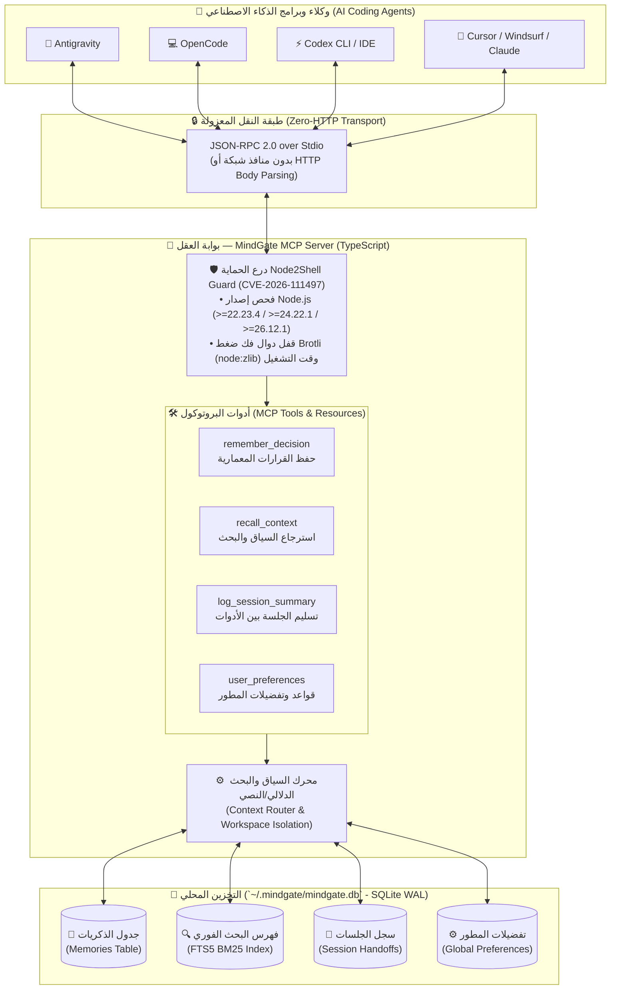

# 🧠 بوابة العقل (MindGate MCP)

**الذاكرة الموحدة والمرجع المركزي لوكلاء الذكاء الاصطناعي (Antigravity • OpenCode • Codex • Cursor • Claude)**

[English Documentation (README.md)](./README.md)

**بوابة العقل (MindGate)** هي خادم بروتوكول سياق النماذج (**MCP Server**) مفتوح المصدر، مجاني بالكامل (100% Local-First)، ومحصّن أمنياً ضد ثغرة **Node2Shell (CVE-2026-111497)**. يعمل كـ "عقل مشترك" وذاكرة دائمة تربط بين جميع أدوات البرمجة بالذكاء الاصطناعي على جهازك، بحيث تتذكر كل أداة قراراتك المعمارية، تفضيلاتك البرمجية، وآخر نقطة توقفت عندها في أي جلسة سابقة دون الحاجة لإعادة شرح مشروعك من الصفر.

## 🌟 لماذا بوابة العقل (MindGate)؟

عند التنقل بين **Antigravity** و **OpenCode** و **Codex**، يفقد كل برنامج السياق الذي بنيته مع البرنامج الآخر. تحل **بوابة العقل** هذه المشكلة عبر توفير:

* **ذاكرة محلية مجانية 100% (Zero-Cost & Local-First):** تخزين كافة الذكريات والقرارات محلياً في قاعدة بيانات `SQLite` مع محرك البحث النصي الفوري `FTS5 (BM25)` على جهازك بدون أي اشتراكات سحابية أو مفاتيح API مدفوعة.
* **تسليم السياق بين الوكلاء (Cross-Agent Handoff):** ابدأ تصميم المعمارية على Antigravity، وسجّل ملخص الجلسة، ثم افتح OpenCode أو Codex ليكمل كتابة الكود من نفس النقطة تلقائياً.
* **عزل المشاريع مع ذاكرة عامة (Workspaces + Global Brain):** فصل ذكريات كل مشروع في مساحة عمل مستقلة (`workspace`)، مع الاحتفاظ بتفضيلاتك الشخصية وقواعد الكود النظيف (`Clean Code`) في ذاكرة عامة مشتركة.
* **تحصين أمني مدمج ضد ثغرة Node2Shell (`CVE-2026-111497`):** يعمل حصرياً عبر قناة `stdio` المعزولة بدون فتح منافذ HTTP، ويفرض الإصدارات المرقّعة من Node.js، كما يعطّل دوال فك ضغط `Brotli` (`node:zlib`) برمجياً وقت التشغيل لحماية المستخدمين حتى على الأنظمة التي تستخدم مكتبات نظام غير محدّثة.

## 🏗️ الرسم المعماري للنظام (System Architecture)

يوضح الرسم المعماري التالي كيف تعمل **بوابة العقل** كطبقة ذاكرة موحدة ومعزولة أمنياً بين مختلف برامج الذكاء الاصطناعي وقاعدة البيانات المحلية:



### مخطط تدفق البيانات النصي (ASCII Architecture Diagram)

```text
+-------------------+     +-------------------+     +-------------------+
|    Antigravity    |     |     OpenCode      |     |       Codex       |
+---------+---------+     +---------+---------+     +---------+---------+
          |                         |                         |
          +-------------------------+-------------------------+
                                    |
                     [ JSON-RPC 2.0 via Local STDIO ]
                     (No HTTP Server / No Brotli I/O)
                                    |
                                    v
+-----------------------------------------------------------------------+
|                    MINDGATE MCP SERVER (بوابة العقل)                  |
|                                                                       |
|  +-----------------------------------------------------------------+  |
|  | 1. Node2Shell Security Guard (CVE-2026-111497 Protection)       |  |
|  |    - Validates Runtime Version (Node >=22.23.4 / 24.22.1 / 26)  |  |
|  |    - Hard-Blocks node:zlib Brotli Decompression APIs            |  |
|  +-----------------------------------------------------------------+  |
|                                   |                                   |
|                                   v                                   |
|  +-----------------------------------------------------------------+  |
|  | 2. MCP Tool & Resource Router                                   |  |
|  |    - remember_decision()       - log_session_summary()          |  |
|  |    - recall_context()          - set/get_user_preferences()     |  |
|  |    - list_workspaces()         - delete_memory()                |  |
|  +-----------------------------------------------------------------+  |
|                                   |                                   |
|                                   v                                   |
|  +-----------------------------------------------------------------+  |
|  | 3. Local SQLite Engine (~/.mindgate/mindgate.db - WAL Mode)     |  |
|  |    [Memories] + [FTS5 BM25 Search] + [Sessions] + [Preferences] |  |
|  +-----------------------------------------------------------------+  |
+-----------------------------------------------------------------------+
```

## 🛡️ الحماية ضد ثغرة Node2Shell (CVE-2026-111497)

تُعد ثغرة **Node2Shell (`CVE-2026-111497`)** ثغرة كتابة خارج حدود الذاكرة (Out-of-bounds write - `CWE-787`) في مفكك ضغط `Brotli` المدمج في Node.js ومكتبات النظام. صُممت **بوابة العقل** بـ 4 طبقات دفاعية متتالية (Defense-in-Depth):

| طبقة الحماية | كيف تطبقها بوابة العقل (MindGate)؟ |
| :--- | :--- |
| **1. انعدام سطح الهجوم الشبكي (`stdio`)** | لا يفتح الخادم أي منفذ HTTP ولا يستخدم `Express` أو `body-parser` أو `fetch()` خارجي، مما يمنع وصول أي حزم `Content-Encoding: br` خارجية. |
| **2. قيود المحرك الصارمة (`package.json`)** | يفرض الحقل `engines` استخدام إصدارات Node.js المرقّعة رسمياً فقط: `^22.23.4 \|\| ^24.22.1 \|\| >=26.12.1` أو Bun `>=1.4.4`. |
| **3. فحص الإصدار وقت التشغيل (`Runtime Check`)** | يتحقق الدرع الأمني في `src/security/node2shellGuard.ts` من إصدار Node.js فور التشغيل وينبّه المطور إذا كان يستخدم إصداراً قديماً أو منتهي الدعم (مثل Node 20). |
| **4. تعطيل مفكك Brotli برمجياً (`Zlib Lock`)** | يقوم الخادم بتجميد وتعطيل دوال `zlib.createBrotliDecompress` و `zlib.brotliDecompress` داخل العملية لحماية الأنظمة التي تعتمد على حزم `libbrotli` مشتركة غير محدّثة في نظام التشغيل. |

## 🛠️ الأدوات المتاحة لوكلاء الذكاء الاصطناعي (MCP Tools)

بمجرد ربط **بوابة العقل** بأي برنامج، يحصل الذكاء الاصطناعي تلقائياً على الأدوات التالية:

| اسم الأداة | الوظيفة | متى يستخدمها الذكاء الاصطناعي؟ |
| :--- | :--- | :--- |
| `remember_decision` | حفظ قرار معماري، قاعدة كود، أو سبب إصلاح خطأ (Bugfix) مع وسوم (`tags`) ومساحة عمل (`workspace`). | عندما تتخذ قراراً مهماً في المشروع وتريد من كل الأدوات تذكره دائماً. |
| `recall_context` | بحث فوري عبر `FTS5 BM25` في الذكريات السابقة، القرارات، وملخص آخر جلسة عمل. | في بداية أي محادثة جديدة أو قبل تعديل ملفات حساسة في المشروع. |
| `log_session_summary` | تسجيل ملخص ما تم إنجازه، الملفات المعدّلة، والخطوات المتبقية (`next_steps`). | عند انتهاء جلستك على Antigravity مثلاً قبل الانتقال إلى OpenCode أو Codex. |
| `set_user_preference` | حفظ تفضيل برمجي عام للمطور (مثل: اللغات المفضلة، أسلوب التسمية، المكتبات الممنوعة). | عندما تخبر المساعد بتفضيل عام يسري على كل مشاريعك. |
| `get_user_preferences` | جلب كافة تفضيلات المطور الشخصية وقواعده العامة. | عند بدء مشروع جديد لكتابة كود يطابق أسلوبك الشخصي. |
| `list_workspaces` | عرض جميع مساحات العمل (المشاريع) المسجلة وإحصائيات الذكريات في كل منها. | لاستكشاف المشاريع المحفوظة في بوابة العقل. |
| `delete_memory` | حذف ذاكرة قديمة أو قرار تم التراجع عنه بواسطة المعرّف (`id`). | عند تحديث معمارية المشروع وإلغاء قرار قديم. |

## 🚀 التثبيت السريع والإعداد (Quick Start)

### 1. المتطلبات الأساسية
* إصدار **Node.js** محدث وآمن (`v22.23.4+` أو `v24.22.1+` أو `v26.12.1+`).

### 2. تحميل وتشغيل المشروع محلياً

```bash
git clone https://github.com/your-username/mindgate-mcp.git
cd mindgate-mcp
npm install
npm run build
```

لعرض إعدادات الربط الجاهزة لكل البرامج في الطرفية:

```bash
node dist/index.js init
```

## 🔌 طريقة الربط مع برامج الذكاء الاصطناعي

### 1. الربط مع Antigravity / Claude Desktop / Cursor
أضف الإعداد التالي داخل ملف إعدادات `mcpServers` الخاص بالبرنامج (أو عبر النشر على npm واستخدام `npx -y mindgate-mcp`):

```json
{
  "mcpServers": {
    "mindgate": {
      "command": "node",
      "args": ["/absolute/path/to/mindgate-mcp/dist/index.js"],
      "env": {
        "MINDGATE_DEFAULT_WORKSPACE": "my-project"
      }
    }
  }
}
```

### 2. الربط مع OpenCode (`opencode.json`)
أضف البوابة في ملف `~/.config/opencode/opencode.json` أو ملف `opencode.json` داخل مشروعك:

```json
{
  "mcp": {
    "mindgate": {
      "type": "local",
      "command": ["node", "/absolute/path/to/mindgate-mcp/dist/index.js"],
      "enabled": true
    }
  }
}
```

### 3. الربط مع Codex CLI (`~/.codex/config.toml`)
أضف القسم التالي في ملف إعدادات Codex:

```toml
[mcp_servers.mindgate]
command = "node"
args = ["/absolute/path/to/mindgate-mcp/dist/index.js"]
```

## 📂 هيكل المشروع (Project Structure)

```text
mindgate-mcp/
├── package.json                  # إعدادات الحزمة وقيود الحماية ضد Node2Shell
├── tsconfig.json                 # إعدادات مترجم TypeScript
├── README.ar.md                  # التوثيق الكامل باللغة العربية مع الرسم المعماري
├── README.md                     # التوثيق الكامل باللغة الإنجليزية مع الرسم المعماري
├── LICENSE                       # رخصة المصدر المفتوح MIT
└── src/
    ├── index.ts                  # نقطة الدخول الرئيسية لخادم MCP وأدوات CLI
    ├── security/
    │   └── node2shellGuard.ts    # درع الحماية ضد ثغرة CVE-2026-111497 (Node2Shell)
    └── db/
        └── memoryStore.ts        # محرك قاعدة بيانات SQLite + البحث النصي FTS5
```

## 🤝 المساهمة في المشروع (Contributing)

هذا المشروع مفتوح المصدر بالكامل للمجتمع العربي والعالمي تحت رخصة **MIT License**. نرحب بجميع المساهمات (Pull Requests) لإضافة مزايا جديدة مثل لوحة تحكم محلية (Web UI) أو دعم البحث الدلالي المحلي عبر `Transformers.js`.
