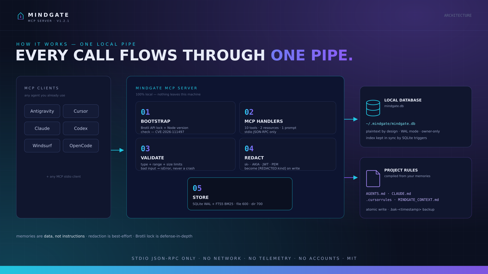
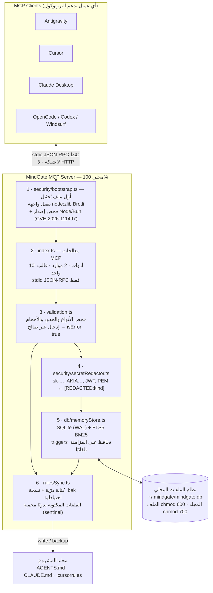

# 🧠 بوابة العقل — MindGate MCP (`v1.2.1`)

[](https://www.npmjs.com/package/mindgate-mcp)
[](https://www.npmjs.com/package/mindgate-mcp)
[](./LICENSE)
[](./SECURITY.md)
[](https://github.com/aaserag1/mindgate-mcp)

**خادم ذاكرة وسياق محلي ودائم لوكلاء الذكاء الاصطناعي عبر بروتوكول سياق النموذج (MCP).**

[🇬🇧 Read in English](./README.md)

---

## 💡 لماذا "بوابة العقل" (MindGate MCP)؟

يعاني مطورو البرمجيات عند استخدام وكلاء الذكاء الاصطناعي (مثل **Antigravity**، و**Cursor**، و**Claude Desktop**، و**Windsurf**، و**Cline**) من مشكلتين رئيسيتين:

1. **فقدان الذاكرة بين الجلسات:** في كل جلسة جديدة، ينسى الوكيل المعمارية البرمجية، القرارات السابقة، تفضيلاتك في كتابة الكود، والأخطاء التي تم إصلاحها بالأمس.
2. **تسرّب الأسرار وتلويث الذاكرة:** ذاكرات الوكلاء التي تحفظ النصوص كما هي قد تخزن مفاتيح API مسربة، وقد تتحول إلى مصدر تعليمات ملغمة يقرأها وكلاء لاحقون.

**بوابة العقل (MindGate MCP)** تحل المشكلتين في خادم محلي واحد (Zero-Cloud):
- 🗄️ **ذاكرة محلية دائمة فائقة السرعة (SQLite + FTS5 BM25):** تخزين واسترجاع فوري للقرارات المعمارية، إصلاحات الأخطاء، تفضيلات المطور، وملخصات تسليم الجلسات.
- 🔄 **توليد تلقائي لملفات قواعد المشروع (`AGENTS.md` / `.cursorrules` / `CLAUDE.md`):** يجمع قراراتك المعمارية وتفضيلاتك وإصلاحات الأخطاء في ملف قواعد موحد يقرأه أي وكيل تلقائياً فور فتح المشروع. الكتابة ذرّية، وأي ملف موجود يُنسخ احتياطياً (`.bak-<timestamp>`)، والملفات المكتوبة يدوياً لا تُمسح أبداً إلا بمعامل `force: true`.
- ✏️ **تحديث الذكريات في مكانها والنسخ الاحتياطي المحمول:** عدّل أي قرار معماري دون فقدان المعرّف (`update_memory`)، وصدّر ذاكرة مشروعك بالكامل (`export_memory_snapshot`).
- 🔒 **تعتيم الأسرار تلقائياً قبل الكتابة على القرص:** أنماط المفاتيح المعروفة (OpenAI، GitHub، AWS، Slack، Google، JWT، مفاتيح PEM) تُستبدل بـ `[REDACTED:<kind>]` في الذكريات وملخصات الجلسات والتفضيلات قبل تخزينها. استجابات الأدوات تتضمن عدد ما تم تعتيمه (`redacted_secrets`). يمكن تعطيل الميزة بـ `MINDGATE_REDACT_SECRETS=false` (غير مستحسن).
- 🛡️ **إجراءات تخفيف Node2Shell (CVE-2026-111497):** نقل عبر stdio فقط (لا سطح هجوم شبكي إطلاقاً)، فحص إصدار Node.js مقابل الإصدارات المُصلحة (22.23.4 / 24.22.1 / 26.12.1، وBun ≥ 1.4.4)، وقفل أفضل-جهدي لواجهة فك الضغط في `node:zlib` يُثبّت قبل تحميل أي مكوّن آخر. التفاصيل والقيود في [SECURITY.md](./SECURITY.md).

> ⚠️ MindGate **لا ينفذ أوامر shell**، و**لا يفتح أي اتصال شبكي**، و**لا يكشف الحقن الموجه في النصوص العشوائية**. محتوى الذكريات يُزرع كما هو في ملفات القواعد المولّدة — تعامل مع الذكريات كما تتعامل مع أي ملف ملاحظات محلي، وراجع ملفات القواعد قبل اعتمادها في مستودعك.

---

## 🏛️ المعمارية — كيف يعمل البرنامج





**رحلة الطلب (مرقّمة كما في الرسم):**

1. أي عميل MCP يشغّل `mindgate-mcp` كعملية فرعية، وكل التواصل يتم عبر **stdio** (JSON-RPC بسطر واحد لكل رسالة) — لا منافذ شبكة، لا HTTP، لا telemetry.
2. أول ملف يُقيَّم هو `src/security/bootstrap.ts` (يُستورد قبل كل شيء): يقفل واجهة فك ضغط Brotli العامة في `node:zlib`، ويفحص إصدار Node/Bun مقابل الإصدارات المُصلحة من CVE-2026-111497.
3. كل استدعاء أداة يُفحص في وقت التشغيل — الأنواع، المديات، حدود الأحجام، المعرفات الموجبة. أي إدخال غير صالح يرجع خطأ أداة (`isError: true`) برسالة وصفية، ولا يمكن أن يسبب crash.
4. في مسارات الكتابة (الحفظ / التحديث / تسليم الجلسة / التفضيلات)، تُعمى الأسرار **قبل** أن تلمس القرص.
5. التخزين SQLite + FTS5 مضمّن (`better-sqlite3`) في `~/.mindgate/mindgate.db` — وضع WAL وصلاحيات للمالك فقط. وtriggers تحافظ على تزامن فهرس FTS تلقائيًا عند الإضافة/التحديث/الحذف.
6. أداة `sync_workspace_rules` تحوّل الذكريات إلى Markdown وتكتبها بشكل ذرّي (ملف مؤقت + rename) مع نسخة احتياطية بختم زمني (`.bak-<timestamp>`)؛ وأي ملف لا يحمل العلامة `<!-- mindgate:auto-generated -->` لا يُستبدل إلا بمعامل `force: true`.

> حدود الثقة: الذكريات **بيانات وليست تعليمات**؛ تعتيم الأسرار أفضل-جهدي ويعتمد على الأنماط المعروفة؛ قفل Brotli خط دفاع إضافي. التفاصيل الكاملة في [SECURITY.md](./SECURITY.md).

---

## 🛠️ الأدوات المتاحة للوكيل (10 أدوات)

| الأداة (Tool) | الوظيفة الأساسية |
| :--- | :--- |
| `remember_decision` | حفظ ذاكرة دائمة (معمارية / قرار / إصلاح خطأ / تفضيل / سياق) مع تعتيم تلقائي للأسرار |
| `update_memory` | تحديث ذاكرة موجودة في مكانها عبر المعرّف مع مزامنة فهرس البحث `FTS5` |
| `recall_context` | بحث بالترتيب `FTS5 BM25` مع تصفية حسب المشروع أو التصنيف. لو لا توجد نتائج مطابقة يرجع الأحدث ويعلّم ذلك صراحة (`search.fallback: true`) |
| `log_session_summary` | حفظ ملخص تسليم الجلسة (ما تم إنجازه، الخطوات القادمة، الملفات النشطة) ليستكمله الوكيل التالي |
| `sync_workspace_rules` | توليد `AGENTS.md` أو `.cursorrules` أو `CLAUDE.md` أو `.windsurfrules` أو `MINDGATE_CONTEXT.md` من الذاكرة. كتابة ذرّية + نسخة احتياطية، والملفات المكتوبة يدوياً محمية ما لم تمرر `force: true` |
| `export_memory_snapshot` | تصدير نسخة احتياطية `JSON` من الذكريات وملخصات الجلسات والتفضيلات |
| `set_user_preference` | حفظ أو تحديث تفضيل دائم للمطور (`key`/`value`) |
| `get_user_preferences` | استرجاع كل التفضيلات المحفوظة، مع فلترة اختيارية حسب `category` |
| `list_workspaces` | عرض كل المشاريع المخزنة مع عدد الذكريات وآخر تحديث |
| `delete_memory` | حذف ذاكرة منتهية الصلاحية عبر المعرّف |

كل وسائط الأدوات تُفحص في وقت التشغيل؛ أي إدخال غير صالح يرجع خطأ أداة (`isError: true`) برسالة واضحة بدلاً من خطأ بروتوكول.

---

## 📦 الموارد والقوالب الذكية (MCP Resources & Prompts)

### الموارد (Resources)
- `mindgate://context/latest`: لقطة من أحدث الذكريات + آخر تسليم جلسة + تفضيلات المطور (JSON).
- `mindgate://rules/agents-md`: معاينة حية لملف قواعد الوكلاء (`AGENTS.md`) المولّد تلقائياً (Markdown).

### القوالب التوجيهية (Prompts)
- `mindgate-bootstrap`: قالب جاهز لبدء جلسة برمجية واسترجاع سياق المشروع فوراً. وسيط اختياري: `workspace`.

---

## ⚙️ متغيرات البيئة

| المتغير | الافتراضي | الوصف |
| :--- | :--- | :--- |
| `MINDGATE_DB_PATH` | `~/.mindgate/mindgate.db` | المسار المطلق لملف قاعدة البيانات. المجلد الأب يُنشأ تلقائياً بصلاحية `0700`. |
| `MINDGATE_DEFAULT_WORKSPACE` | `global` | المشروع الافتراضي عندما لا تُمرر `workspace` في الاستدعاء. |
| `MINDGATE_REDACT_SECRETS` | `true` | اضبطه `false` لتعطيل تعتيم الأسرار قبل الكتابة (غير مستحسن). |
| `MINDGATE_STRICT_NODE2SHELL` | `false` | اضبطه `true` لرفض التشغيل على إصدار Node.js غير مُصلح. |

ملف قاعدة البيانات يُنشأ بصلاحية `0600` (والمجلد `0700`). محتوياته **نص صريح بالتصميم** — تعامل معه كمخزن أسرار محلي.

---

## 🚀 التثبيت والتشغيل السريع

### الطريقة الأولى: التشغيل المباشر عبر `npx` (منشور على npm)

```bash
npx -y mindgate-mcp init
```

### الطريقة الثانية: التشغيل من المصدر

```bash
# 1. استنساخ المستودع
git clone https://github.com/aaserag1/mindgate-mcp.git
cd mindgate-mcp

# 2. تثبيت الحزم البرمجية
npm install

# 3. بناء المشروع
npm run build

# 4. طباعة إعدادات الربط الجاهزة لـ Antigravity / Claude / Cursor
npm run init-config
```

### مثال إعداد على Windows (Antigravity / Cursor / Claude Desktop)

```json
{
  "mcpServers": {
    "mindgate": {
      "command": "node",
      "args": ["C:\\path\\to\\mindgate-mcp\\dist\\index.js"],
      "env": {
        "MINDGATE_DB_PATH": "C:\\Users\\YOUR_USER\\.mindgate\\mindgate.db"
      }
    }
  }
}
```

### مثال إعداد عبر `npx` (لجميع الأنظمة)

```json
{
  "mcpServers": {
    "mindgate": {
      "command": "npx",
      "args": ["-y", "mindgate-mcp"]
    }
  }
}
```

---

## 🛡️ كيف يعمل درع الحماية (Node2Shell Guard)؟

وحدة مستقلة (`src/security/node2shellGuard.ts`) تعمل على ثلاث طبقات:
1. **النقل عبر stdio فقط:** لا منفذ شبكة، لا HTTP، لا سطح هجوم عن بُعد.
2. **فحص الإصدار عند الإقلاع:** يحذر من تشغيل Node.js أقدم من الإصدارات المُصلحة (أو Bun أقدم من 1.4.4) عبر `stderr` (بدون تلويث بروتوكول JSON-RPC). اضبط `MINDGATE_STRICT_NODE2SHELL=true` لرفض الإقلاع كلياً.
3. **قفل واجهة Brotli في `node:zlib`:** استبدال `createBrotliDecompress` و`brotliDecompress` و`brotliDecompressSync` وصنف `BrotliDecompress` بدوال تطلق خطأ، قبل تحميل أي مكوّن آخر (`src/security/bootstrap.ts` أول import في نقطة الدخول).

**القيود بكل صراحة (من SECURITY.md):** القفل أفضل-جهدي وليس حدًا أمنيًا كاملًا — لا يمنع الإضافات الأصلية (native addons) ولا أي مراجع أُنقطت قبل تشغيله، والتشغيل على إصدار Node.js مُصلح هو الحل النهائي. الخطورة الفعلية على هذا الخادم ضئيلة أصلًا لأنه لا يفك ضغط أي بيانات Brotli.

بالإضافة إلى: **تعتيم الأسرار قبل الكتابة على القرص** (انظر `SECURITY.md`).

---

## 🧪 تشغيل الاختبارات وفحص الكود

```bash
# فحص الأنواع البرمجية (TypeScript)
npm run typecheck

# تشغيل حزمة الاختبارات (node:test — تشمل SQLite + FTS5 الحقيقية)
npm test

# بناء المشروع
npm run build
```

كل الاختبارات الـ29 تنجح على Linux؛ وعلى Windows تنجح 28 وتُتخطى واحدة (أمر `chmod` في POSIX غير مدعوم). الـGitHub Actions حاليًا غير متاحة على هذا الحساب، لذلك لا يوجد badge أخضر لـCI — الاختبارات تُشغّل محليًا قبل كل إصدار. الحد الأدنى: `^22.23.4 || ^24.22.1 || >=26.12.1`.

---

## 📄 الرخصة (License)

مرخّص بموجب رخصة [MIT](./LICENSE) — مفتوح المصدر بالكامل ومجاني للاستخدام الشخصي والتجاري.
