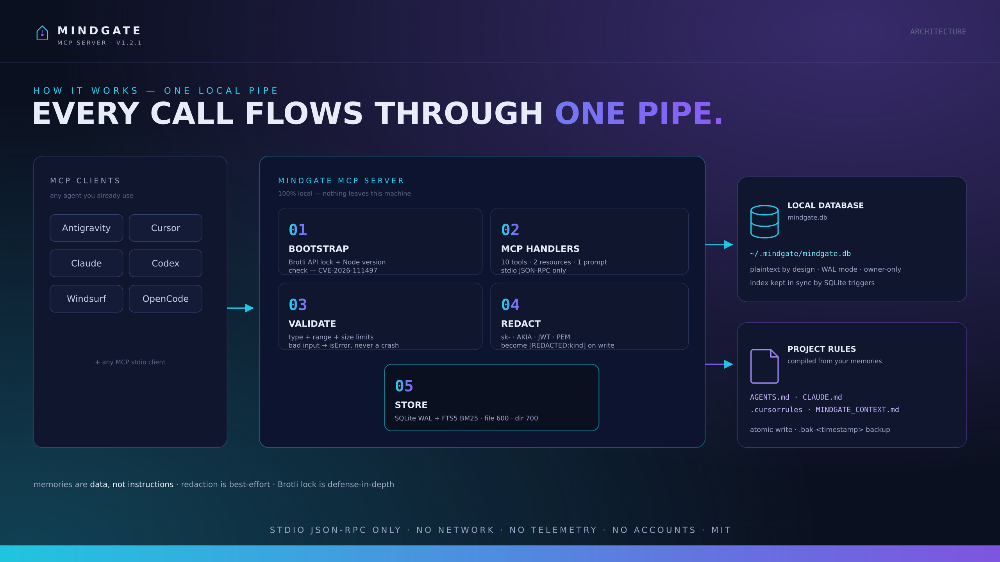
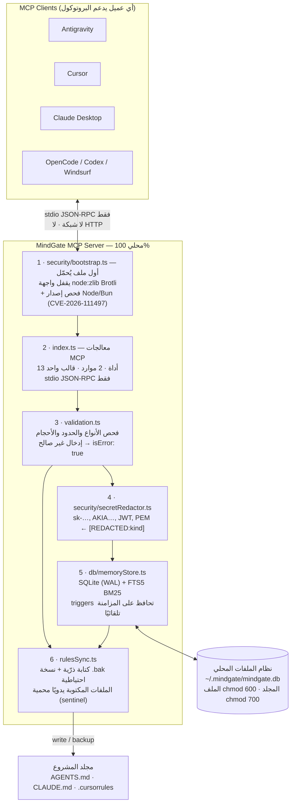

# 🧠 بوابة العقل — MindGate MCP (`v1.5.0`)

[](https://www.npmjs.com/package/mindgate-mcp)
[](https://www.npmjs.com/package/mindgate-mcp)
[](./LICENSE)
[](./SECURITY.md)
[](https://github.com/aaserag1/mindgate-mcp)

**توقف عن إعادة شرح مشروعك للذكاء الاصطناعي كل صباح.**  
**خادم ذاكرة وسياق محلي 100%** لـ **Cursor** و**Claude Desktop** و**Antigravity** و**Windsurf** و**Codex** — مبني على `SQLite + FTS5`، مع تعتيم تلقائي للأسرار وتوليد تلقائي لملفات قواعد المشروع (`AGENTS.md` / `.cursorrules` / `CLAUDE.md`).

[🇬🇧 Read in English](./README.md) · [🖥️ صفحة المشروع](https://aaserag1.github.io/mindgate-mcp/) · [📦 npm](https://www.npmjs.com/package/mindgate-mcp) · [🎬 فيديو العرض (58 ثانية)](./docs/video/mindgate-launch.mp4)

<!-- نصيحة: استبدل السطر التالي بصورة GIF قصيرة (مثل ./docs/video/mindgate-demo.gif) لتعمل تلقائيًا داخل الصفحة -->
> 🎬 **[شاهد العرض التوضيحي (58 ثانية)](./docs/video/mindgate-launch.mp4)** — ابدأ العمل في Cursor، وانتقل إلى Claude Desktop أو Antigravity بنفس الذاكرة دون فقدان أي سياق.

---

## ⚡ التشغيل السريع (في 30 ثانية)

### 1. التشغيل المباشر عبر `npx` (بدون تثبيت مسبق)

```bash
npx -y mindgate-mcp init
```

### 2. الإضافة إلى Cursor / Claude Desktop / Antigravity

```json
{
  "mcpServers": {
    "mindgate": {
      "command": "npx",
      "args": ["-y", "mindgate-mcp"]
    }
  }
}
```

### 3. التثبيت بنقرة واحدة عبر Smithery (لـ Claude Desktop)

```bash
npx -y @smithery/cli install mindgate-mcp --client claude
```

<details>
<summary>أو البناء والتشغيل من الكود المصدري (Windows / macOS / Linux)</summary>

```bash
git clone https://github.com/aaserag1/mindgate-mcp.git
cd mindgate-mcp
npm install
npm run build
npm run init-config
```

```json
{
  "mcpServers": {
    "mindgate": {
      "command": "node",
      "args": ["C:\\path\\to\\mindgate-mcp\\dist\\index.js"],
      "env": {
        "MINDGATE_DB_PATH": "C:\\Users\\YOUR_USER\\.mindgate\\mindgate.db"
      }
    }
  }
}
```

</details>

---

## 🆚 لماذا MindGate مقارنة بالبدائل؟

| الميزة | **MindGate MCP** | [Mem0 MCP](https://mem0.ai/openmemory) | [Basic Memory](https://docs.basicmemory.com/integrations/cursor) |
| :--- | :--- | :--- | :--- |
| **محلي 100% (بدون سحابة أو API Key)** | ✅ قاعدة SQLite + FTS5 محلية | ❌ خدمة سحابية / مفتاح API | ✅ ملفات Markdown محلية |
| **مشاركة السياق بين الوكلاء (Cursor ↔ Claude ↔ Codex)** | ✅ تسليم جلسات منظم | ✅ عبر الأدوات | ✅ عبر الأدوات |
| **توليد تلقائي لـ `AGENTS.md` / `.cursorrules` / `CLAUDE.md`** | ✅ كتابة ذرّية + نسخة `.bak` | ❌ | ❌ |
| **تعتيم الأسرار تلقائيًا قبل الحفظ** | ✅ إخفاء مفاتيح API وJWT | ❌ | ❌ |
| **لوحة تحكم ويب محلية + خطاف Git** | ✅ مدمجة (`127.0.0.1:4242`) | ❌ | ❌ |
| **بحث دلالي ثنائي اللغة (عربي ↔ إنجليزي) أوفلاين** | ✅ ملف ONNX اختياري | ❌ | ❌ |

---

## 💡 المميزات الأساسية

* **🗄️ ذاكرة محلية فائقة السرعة (`SQLite + FTS5 BM25`):** تخزين واسترجاع فوري للقرارات المعمارية، إصلاحات الأخطاء، التفضيلات، وملخصات تسليم الجلسات — بدون أي اتصال شبكي أو telemetry.
* **🔄 توليد تلقائي لملفات قواعد المشروع:** أداة `sync_workspace_rules` تجمع قراراتك في `AGENTS.md` أو `.cursorrules` أو `CLAUDE.md` أو `.windsurfrules` أو `MINDGATE_CONTEXT.md`. الكتابة ذرّية مع نسخة احتياطية (`.bak-<timestamp>`)، والملفات المكتوبة يدويًا محمية إلا بتمرير `force: true`.
* **🔒 تعتيم الأسرار تلقائيًا قبل الكتابة:** أنماط المفاتيح المعروفة (OpenAI، GitHub، AWS، Slack، Google، JWT، مفاتيح PEM) تُستبدل بـ `[REDACTED:<kind>]` قبل لمس القرص. يمكنك تعطيلها بـ `MINDGATE_REDACT_SECRETS=false` (غير مستحسن).
* **🔄 دورة حياة القرارات وضغط الجلسات:** إبطال القرارات القديمة (`supersedes`) أو وسمها كمهملة (`deprecate_memory`)، وتحديثها في مكانها (`update_memory`)، وضغط سلاسل الجلسات الطويلة (`compact_memories`) لتوفير الـ Tokens.
* **🔍 بحث دلالي هجين وثنائي اللغة عربي ↔ إنجليزي (`v1.4.0`–`v1.5.0`):** يدمج BM25 مع تضمينات ONNX محلية (`all-MiniLM-L6-v2`، ~23 ميجابايت، 384 بُعدًا) وملف `multilingual` عبر `mindgate-mcp download-model --multilingual` لاسترجاع القرارات الإنجليزية باستعلامات عربية أوفلاين بالكامل.
* **🖥️ لوحة تحكم ويب محلية (`127.0.0.1:4242`):** واجهة بدون تبعيات خارجية (`mindgate-mcp ui`) تدعم الوضع الليلي والنهاري، والتبديل بين العربية (RTL) والإنجليزية (LTR)، والبحث الفوري، وتصدير JSON.
* **🪝 محوّل خطاف Git:** تسجيل تلقائي لرسائل الـ Commit والملفات المعدلة عبر `mindgate-mcp git-hook install` دون تعطيل سير العمل.
* **🛡️ حماية Node2Shell (CVE-2026-111497):** اتصال عبر `stdio` فقط (بدون منافذ شبكة)، وفحص إصدار Node/Bun، وقفل واجهة `node:zlib` Brotli قبل تحميل أي مكوّن آخر. التفاصيل في [SECURITY.md](./SECURITY.md).

> ⚠️ MindGate **لا ينفذ أوامر shell**، و**لا يفتح أي منفذ شبكي لبروتوكول MCP**، و**لا يكشف الحقن الموجه في النصوص العشوائية**. راجع ملفات القواعد المولّدة قبل اعتمادها في مستودعك.

---

## 🖥️ لوحة التحكم المحلية عبر الويب

```bash
mindgate-mcp ui              # التشغيل على http://127.0.0.1:4242
mindgate-mcp ui --port 5050  # تحديد منفذ مخصص
npm run ui                   # عند التشغيل من الكود المصدري
```

* **إدارة بصرية للذكريات:** بحث فوري بتقنية FTS5 BM25، شارات الحالة (`نشط`، `مستبدل`، `مهمل`)، وفلترة حسب المشروع والتصنيف.
* **دعم العربية والإنجليزية:** تبديل فوري بين العربية (RTL) والإنجليزية (LTR) مع الوضع الليلي والنهاري.
* **الفتح التلقائي مع عملاء MCP:** أضف `--open-dashboard` (واختياريًا `--port 5050`) إلى `args` في إعدادات العميل.

---

## 🪝 محوّل خطاف Git (`Post-Commit Hook`)

```bash
mindgate-mcp git-hook install
mindgate-mcp git-hook install --workspace my-project
mindgate-mcp git-hook uninstall
```

يضيف مهمة خلفية غير معطلة إلى `.git/hooks/post-commit` محصورة بعلامات `# --- mindgate:post-commit ---` للحفاظ على أي خطافات سابقة لديك.

---

## 🛠️ الأدوات (13) والموارد (2) والقوالب (1)

<details>
<summary>عرض القائمة الكاملة للأدوات الـ 13 والموارد والقوالب</summary>

### الأدوات المتاحة (13 أداة)

| الأداة (Tool) | الوظيفة الأساسية |
| :--- | :--- |
| `remember_decision` | حفظ ذاكرة دائمة (`architecture` / `decision` / `bugfix` / `convention` / `context`) مع تعتيم الأسرار وإمكانية تمرير `supersedes` |
| `update_memory` | تحديث ذاكرة موجودة في مكانها عبر المعرّف مع تحديث `status` ومزامنة فهرس `FTS5` |
| `recall_context` | بحث بتقنية `FTS5 BM25` (والبحث الدلالي عند توفره) مع التصفية بالمشروع والتصنيف والحالة؛ يرجع للأحدث تلقائيًا (`search.fallback: true`) |
| `deprecate_memory` | وسم ذاكرة بأنها مهملة عبر المعرّف مع سبب اختياري دون حذف سجلها التاريخي |
| `compact_memories` | ضغط سجل الجلسات التاريخية إلى ملخصات معالم لتقليل استهلاك الـ Tokens |
| `log_session_summary` | حفظ ملخص تسليم الجلسة (ما تم إنجازه، الخطوات القادمة، الملفات النشطة) للوكيل التالي |
| `get_dashboard_url` | جلب عنوان لوحة التحكم المحلية (`http://127.0.0.1:4242`) |
| `sync_workspace_rules` | توليد `AGENTS.md` أو `.cursorrules` أو `CLAUDE.md` أو `.windsurfrules` أو `MINDGATE_CONTEXT.md` |
| `export_memory_snapshot` | تصدير نسخة احتياطية `JSON` من الذكريات وملخصات الجلسات والتفضيلات |
| `set_user_preference` | حفظ أو تحديث تفضيل دائم للمطور (`key`/`value`) |
| `get_user_preferences` | استرجاع كل التفضيلات المحفوظة مع فلترة اختيارية حسب `category` |
| `list_workspaces` | عرض كل المشاريع المخزنة مع عدد الذكريات وآخر تحديث |
| `delete_memory` | حذف ذاكرة عبر المعرّف الخاص بها |

### الموارد (2)
* `mindgate://context/latest` — لقطة من أحدث الذكريات وآخر تسليم جلسة وتفضيلات المطور (JSON).
* `mindgate://rules/agents-md` — معاينة حية لملف `AGENTS.md` المولّد تلقائيًا (Markdown).

### القوالب (1)
* `mindgate-bootstrap` — قالب لبدء الجلسة وتحميل سياق المشروع وتفضيلاته فورًا (`workspace` اختياري).

</details>

---

## 🏛️ المعمارية — كيف يعمل البرنامج



<details>
<summary>عرض مخطط Mermaid المعماري</summary>



</details>

---

## ⚙️ متغيرات البيئة

| المتغير | الافتراضي | الوصف |
| :--- | :--- | :--- |
| `MINDGATE_DB_PATH` | `~/.mindgate/mindgate.db` | المسار المطلق لملف قاعدة البيانات (المجلد `0700` والملف `0600`). |
| `MINDGATE_DEFAULT_WORKSPACE` | `global` | المشروع الافتراضي عند عدم تمرير `workspace`. |
| `MINDGATE_REDACT_SECRETS` | `true` | اضبطه `false` لتعطيل تعتيم الأسرار عند الكتابة (غير مستحسن). |
| `MINDGATE_STRICT_NODE2SHELL` | `false` | اضبطه `true` لرفض الإقلاع على إصدار Node.js غير مُصلح. |

---

## ❓ الأسئلة الشائعة والتوافق

* **ما إصدار Node.js المطلوب؟**  
  **التوافق:** يعمل على Node 20+ (مع قفل واجهة `node:zlib` Brotli كطبقة حماية إضافية).  
  **الموصى به للحماية الكاملة من CVE-2026-111497:** `^22.23.4 || ^24.22.1 || >=26.12.1` (راجع [SECURITY.md](./SECURITY.md)).
* **أين تُحفظ ذاكرتي؟** في `~/.mindgate/mindgate.db` (أو المسار المحدد في `MINDGATE_DB_PATH`). احذف الملف لمسح كل شيء.
* **هل يمكن نقل الذاكرة بين الأجهزة؟** نعم — انسخ ملف `.db` أو استخدم `export_memory_snapshot`.
* **هل يعمل أوفلاين؟** نعم — بعد التثبيت، لا شيء يغادر جهازك إطلاقًا.

<details>
<summary>🪟 حل مشكلة ويندوز (EPERM مع better-sqlite3)</summary>

إذا فشل `npm ci` برسالة `EPERM ... better-sqlite3\prebuilds\win32-x64.node`، فهناك وكيل أو محرر يستخدم الملف:

1. أغلق أي برنامج يستخدم MindGate ونوافذ VS Code المفتوحة على المستودع.
2. نفّذ `Get-Process node | Select-Object Id, Path` ثم `Stop-Process -Id <ID> -Force`.
3. نفّذ `Rename-Item node_modules node_modules.old` ثم `npm ci` ثم `npm test`.
4. احذف `node_modules.old` بعد الانتهاء.

</details>

---

## 🧪 الاختبارات والتحقق

```bash
npm run typecheck   # فحص الأنواع (TypeScript)
npm test            # تشغيل 29 اختبارًا (SQLite + FTS5)
npm run build       # بناء مجلد dist/
```

تنجح الاختبارات الـ 29 كاملة على Linux؛ وعلى Windows تنجح 28 وتُتخطى واحدة (لأن `chmod` في POSIX غير مدعوم).

---

## 📄 الرخصة

مرخّص بموجب رخصة [MIT](./LICENSE) — مفتوح المصدر بالكامل.
