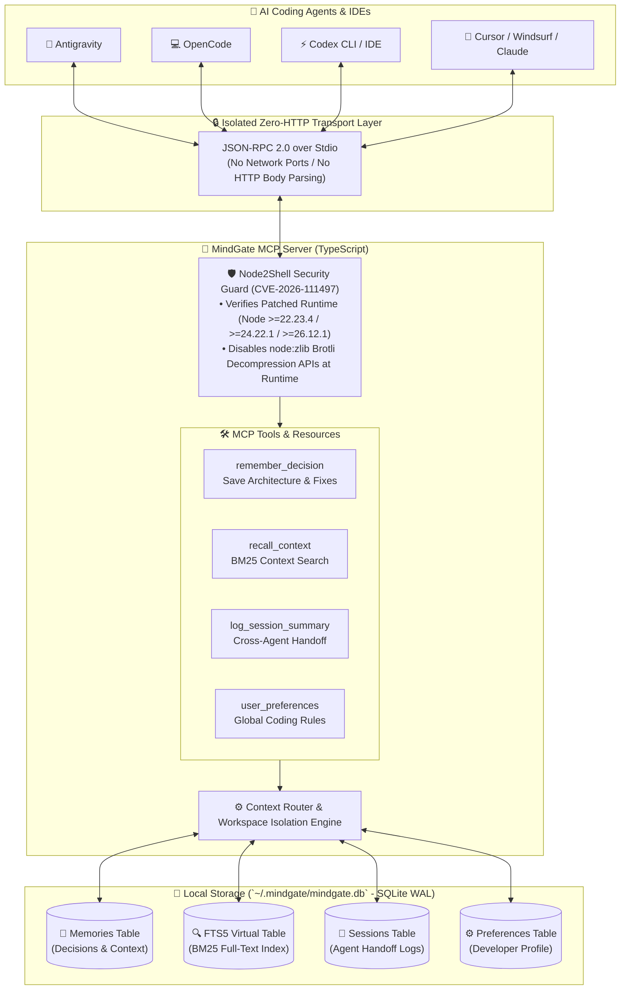

# 🧠 MindGate MCP (بوابة العقل)

**The Unified Local-First Memory & Context Gateway for AI Coding Agents (Antigravity • OpenCode • Codex • Cursor • Claude)**

[التوثيق باللغة العربية (README.ar.md)](./README.ar.md)

**MindGate (بوابة العقل)** is a free, open-source, 100% local-first **Model Context Protocol (MCP)** server engineered to act as a persistent shared brain across all your AI coding assistants. Hardened out of the box against **Node2Shell (`CVE-2026-111497`)**, MindGate remembers your architectural decisions, coding conventions, bug root causes, and cross-session handoffs so you never have to repeat your context when switching between **Antigravity**, **OpenCode**, **Codex**, or **Cursor**.

## 🌟 Why MindGate?

Every time you switch from one AI coding tool to another—or start a fresh session—valuable project context is lost. MindGate solves context fragmentation with:

* **100% Free & Local-First Privacy:** Powered by an embedded `SQLite` database (`WAL` mode) and `FTS5 (BM25)` full-text ranking stored locally in `~/.mindgate/mindgate.db`. Zero paid API keys, zero cloud subscriptions, and zero data leaving your machine.
* **Seamless Cross-Agent Handoffs:** Design your architecture in **Antigravity**, call `log_session_summary`, and immediately pick up implementation in **OpenCode** or **Codex** with full awareness of touched files and next steps.
* **Project Workspaces + Global Developer Brain:** Isolate project-specific architectural memories by `workspace` while sharing your personal coding preferences and clean-code rules globally across every repository.
* **Built-In Node2Shell (`CVE-2026-111497`) Hardening:** Operates strictly over `stdio` transport (zero HTTP exposure) and includes an active runtime security guard that verifies patched Node.js versions and disables `node:zlib` Brotli decompression routines inside the process.

## 🏗️ System Architecture

The diagram below illustrates how **MindGate** operates as a secure, zero-HTTP memory layer connecting multiple AI agents to a local SQLite + FTS5 knowledge store:



### ASCII Architecture Overview

```text
+-------------------+     +-------------------+     +-------------------+
|    Antigravity    |     |     OpenCode      |     |       Codex       |
+---------+---------+     +---------+---------+     +---------+---------+
          |                         |                         |
          +-------------------------+-------------------------+
                                    |
                     [ JSON-RPC 2.0 via Local STDIO ]
                     (No HTTP Server / No Brotli I/O)
                                    |
                                    v
+-----------------------------------------------------------------------+
|                    MINDGATE MCP SERVER (بوابة العقل)                  |
|                                                                       |
|  +-----------------------------------------------------------------+  |
|  | 1. Node2Shell Security Guard (CVE-2026-111497 Protection)       |  |
|  |    - Validates Runtime Version (Node >=22.23.4 / 24.22.1 / 26)  |  |
|  |    - Hard-Blocks node:zlib Brotli Decompression APIs            |  |
|  +-----------------------------------------------------------------+  |
|                                   |                                   |
|                                   v                                   |
|  +-----------------------------------------------------------------+  |
|  | 2. MCP Tool & Resource Router                                   |  |
|  |    - remember_decision()       - log_session_summary()          |  |
|  |    - recall_context()          - set/get_user_preferences()     |  |
|  |    - list_workspaces()         - delete_memory()                |  |
|  +-----------------------------------------------------------------+  |
|                                   |                                   |
|                                   v                                   |
|  +-----------------------------------------------------------------+  |
|  | 3. Local SQLite Engine (~/.mindgate/mindgate.db - WAL Mode)     |  |
|  |    [Memories] + [FTS5 BM25 Search] + [Sessions] + [Preferences] |  |
|  +-----------------------------------------------------------------+  |
+-----------------------------------------------------------------------+
```

## 🛡️ Node2Shell (`CVE-2026-111497`) Security Architecture

**Node2Shell (`CVE-2026-111497`)** is a critical (`CVSS 9.2`) out-of-bounds write vulnerability (`CWE-787`) in the Brotli decompression library bundled with Node.js and system packages. MindGate implements 4 layers of defense-in-depth:

| Security Layer | MindGate Implementation |
| :--- | :--- |
| **1. Zero-HTTP `stdio` Transport** | MindGate communicates strictly over standard input/output (`StdioServerTransport`). It never exposes an HTTP server, never uses `body-parser`, and never makes outbound `fetch()` requests to untrusted servers. |
| **2. Strict `package.json` Engine Pinning** | Enforces patched runtime versions in `engines`: Node.js `^22.23.4 \|\| ^24.22.1 \|\| >=26.12.1` or Bun `>=1.4.4`, rejecting EOL lines such as Node 20. |
| **3. Startup Runtime Version Audit** | `src/security/node2shellGuard.ts` inspects `process.versions.node` at startup and alerts the developer if an unpatched binary is detected. |
| **4. Runtime `node:zlib` Brotli Lock** | Actively neutralizes `zlib.createBrotliDecompress`, `zlib.brotliDecompress`, and `zlib.brotliDecompressSync` in-process, protecting Linux distributions that dynamically link against unpatched system `libbrotli` packages. |

## 🛠️ Available MCP Tools

Once connected, your AI coding assistant gains immediate access to the following tools:

| Tool Name | Description | Typical AI Trigger |
| :--- | :--- | :--- |
| `remember_decision` | Stores an architectural decision, convention, bug root cause, or context snippet with `workspace` and `tags`. | When you establish a project rule or solve a tricky bug. |
| `recall_context` | Searches project and global memories via SQLite `FTS5 (BM25)` and returns the latest session handoff. | At the start of a task or before refactoring core modules. |
| `log_session_summary` | Records what was accomplished, modified files (`active_files`), and pending `next_steps`. | Before closing Antigravity so OpenCode or Codex can continue seamlessly. |
| `set_user_preference` | Saves a global developer preference (e.g., preferred stack, naming conventions, forbidden libraries). | When you state a coding habit that applies to all projects. |
| `get_user_preferences` | Retrieves all saved developer preferences and coding standards. | When bootstrapping or writing code in any workspace. |
| `list_workspaces` | Lists all active project workspaces along with memory and session counts. | When auditing stored project contexts. |
| `delete_memory` | Deletes an outdated or superseded memory entry by `id`. | When an architectural decision is replaced. |

## 🚀 Quick Start & Installation

### 1. Prerequisites
* A patched **Node.js** runtime (`v22.23.4+`, `v24.22.1+`, or `v26.12.1+`) or **Bun** (`v1.4.4+`).

### 2. Clone & Build

```bash
git clone https://github.com/your-username/mindgate-mcp.git
cd mindgate-mcp
npm install
npm run build
```

Generate ready-to-paste configuration snippets for your installed tools:

```bash
node dist/index.js init
```

## 🔌 Connecting Your AI Coding Tools

### 1. Antigravity / Claude Desktop / Cursor
Add the following entry to your MCP configuration file (or use `npx -y mindgate-mcp` once published to npm):

```json
{
  "mcpServers": {
    "mindgate": {
      "command": "node",
      "args": ["/absolute/path/to/mindgate-mcp/dist/index.js"],
      "env": {
        "MINDGATE_DEFAULT_WORKSPACE": "my-project"
      }
    }
  }
}
```

### 2. OpenCode (`opencode.json`)
Add MindGate to `~/.config/opencode/opencode.json` or your project's `opencode.json`:

```json
{
  "mcp": {
    "mindgate": {
      "type": "local",
      "command": ["node", "/absolute/path/to/mindgate-mcp/dist/index.js"],
      "enabled": true
    }
  }
}
```

### 3. Codex CLI (`~/.codex/config.toml`)
Add the following block to your `~/.codex/config.toml`:

```toml
[mcp_servers.mindgate]
command = "node"
args = ["/absolute/path/to/mindgate-mcp/dist/index.js"]
```

## 📂 Repository Structure

```text
mindgate-mcp/
├── package.json                  # Package manifest & Node2Shell engine constraints
├── tsconfig.json                 # Strict TypeScript compiler configuration
├── README.md                     # English documentation & architecture diagrams
├── README.ar.md                  # Arabic documentation & architecture diagrams
├── LICENSE                       # MIT Open-Source License
└── src/
    ├── index.ts                  # Main MCP server entrypoint & CLI init helper
    ├── security/
    │   └── node2shellGuard.ts    # Runtime CVE-2026-111497 (Node2Shell) guard & zlib lock
    └── db/
        └── memoryStore.ts        # Local SQLite WAL + FTS5 BM25 storage engine
```

## 🤝 Contributing & License

Released under the **MIT License**. Built for the open-source developer community—contributions, issues, and feature requests (such as local vector embeddings via `Transformers.js` or a local Web UI) are warmly welcome!
