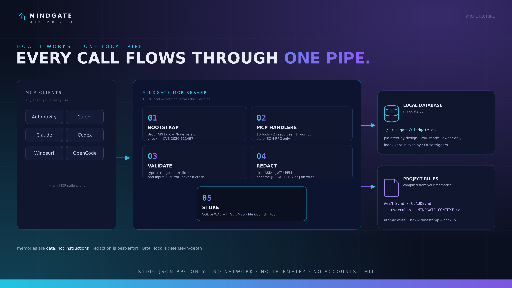
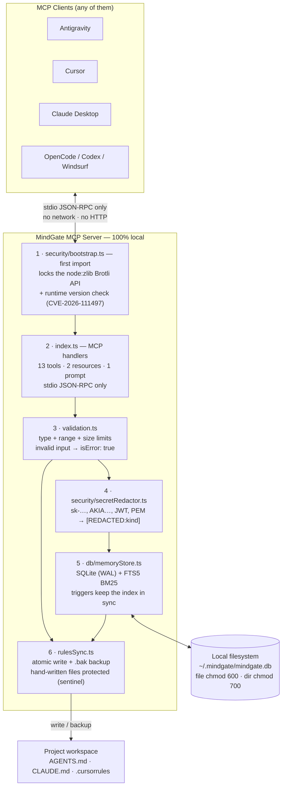

# 🧠 MindGate MCP (`v1.6.0`) — بوابة العقل

[](https://www.npmjs.com/package/mindgate-mcp)
[](https://www.npmjs.com/package/mindgate-mcp)
[](./LICENSE)
[](./SECURITY.md)
[](https://github.com/aaserag1/mindgate-mcp)

**Stop re-explaining your codebase every morning.**  
A **100% local-first persistent memory MCP server** for **Cursor**, **Claude Desktop**, **Antigravity**, **Windsurf**, and **Codex** — backed by SQLite + FTS5, automatic secret redaction, and auto-compiled `AGENTS.md` / `.cursorrules` / `CLAUDE.md` rules.

[🇪🇬 التوثيق بالعربية](./README.ar.md) · [🖥️ Landing Page](https://aaserag1.github.io/mindgate-mcp/) · [📦 npm](https://www.npmjs.com/package/mindgate-mcp) · [🎬 58-second Demo](./docs/video/mindgate-launch.mp4)

<!-- Tip: Replace the link below with an inline GIF (e.g. ./docs/video/mindgate-demo.gif) so visitors see it auto-play right here -->
> 🎬 **[Watch the 58-second demo](./docs/video/mindgate-launch.mp4)** — Start a feature in Cursor, switch to Claude Desktop or Antigravity, and pick up with zero context loss.

---

## ⚡ Quick Start (30 Seconds)

### 1. Run with `npx` (Zero-Install)

```bash
npx -y mindgate-mcp init
```

### 2. Add to Cursor / Claude Desktop / Antigravity

```json
{
  "mcpServers": {
    "mindgate": {
      "command": "npx",
      "args": ["-y", "mindgate-mcp"]
    }
  }
}
```

### 3. Install via Smithery (Claude Desktop)

```bash
npx -y @smithery/cli install mindgate-mcp --client claude
```

<details>
<summary>Or build from source (Windows / macOS / Linux)</summary>

```bash
git clone https://github.com/aaserag1/mindgate-mcp.git
cd mindgate-mcp
npm install
npm run build
npm run init-config
```

```json
{
  "mcpServers": {
    "mindgate": {
      "command": "node",
      "args": ["C:\\path\\to\\mindgate-mcp\\dist\\index.js"],
      "env": {
        "MINDGATE_DB_PATH": "C:\\Users\\YOUR_USER\\.mindgate\\mindgate.db"
      }
    }
  }
}
```

</details>

---

## 🆚 Why MindGate vs. Alternatives?

| Feature | **MindGate MCP** | [Mem0 MCP](https://mem0.ai/openmemory) | [Basic Memory](https://docs.basicmemory.com/integrations/cursor) |
| :--- | :--- | :--- | :--- |
| **100% Local-First (No Cloud / No API Key)** | ✅ SQLite + FTS5 on disk | ❌ Hosted service / API key | ✅ Local Markdown files |
| **Cross-Agent Handoff (Cursor ↔ Claude ↔ Codex)** | ✅ Structured handoffs | ✅ Cross-tool | ✅ Cross-tool |
| **Auto-Compiled `AGENTS.md` / `.cursorrules` / `CLAUDE.md`** | ✅ Atomic write + `.bak` | ❌ | ❌ |
| **Automatic Secret Redaction on Write** | ✅ Masks API keys & JWTs | ❌ | ❌ |
| **Local Web Dashboard + Git Post-Commit Hook** | ✅ Built-in (`127.0.0.1:4242`) | ❌ | ❌ |
| **Offline Cross-Lingual Search (Arabic ↔ English)** | ✅ Optional ONNX profile | ❌ | ❌ |

---

## 💡 Core Capabilities

* **🗄️ Blazing-Fast Local SQLite + FTS5 BM25:** Instant full-text retrieval of architectural decisions, bugfixes, conventions, preferences, and session handoffs — zero network calls, zero telemetry.
* **🔄 Auto-Compiled Workspace Rules:** `sync_workspace_rules` compiles stored decisions into `AGENTS.md`, `.cursorrules`, `CLAUDE.md`, `.windsurfrules`, or `MINDGATE_CONTEXT.md`. Writes are atomic, existing files get a `.bak-<timestamp>` backup, and hand-written files are never overwritten unless `force: true`.
* **🔒 Secret Redaction on Write:** Well-known token patterns (OpenAI, GitHub, AWS, Slack, Google, JWT, PEM private keys) are masked with `[REDACTED:<kind>]` before touching disk. Disable with `MINDGATE_REDACT_SECRETS=false` (not recommended).
* **🔄 Decision Lifecycle & Compaction:** Supersede outdated choices (`supersedes`), deprecate stale notes (`deprecate_memory`), update in-place (`update_memory`), and compact long session histories (`compact_memories`) to save tokens.
* **📒 Assumptions Ledger (`v1.6.0`):** Dated, owned assumption records (`record_assumption`) with a `review_date` and an `owner`. An assumption whose review date has passed is excluded from `recall_context` and listed only under `assumptions_needing_review` until the operator confirms (`confirm_assumption`) or replaces it — so a stale assumption can never be silently reused. `review_assumptions` lists what is overdue and what is due within 7 days.
* **🔍 Optional Hybrid Semantic & Arabic ↔ English Search (`v1.4.0`–`v1.5.0`):** Combines BM25 with offline ONNX embeddings (`all-MiniLM-L6-v2`, ~23 MB, 384-dim) and a `multilingual` profile (`mindgate-mcp download-model --multilingual`) for >0.72 cosine alignment between Arabic queries and English decisions on CPU.
* **🖥️ Built-in Local Web Dashboard:** Zero-dependency UI (`mindgate-mcp ui`) bound strictly to `127.0.0.1:4242` with Dark/Light themes, Arabic RTL & English LTR switch, live search, and JSON export.
* **🪝 Git Post-Commit Hook:** Automatically logs commit messages and active files via `mindgate-mcp git-hook install` without blocking your workflow.
* **🛡️ Node2Shell (CVE-2026-111497) Hardened:** stdio-only transport (zero HTTP attack surface on MCP), runtime version check, and a best-effort in-process lock of `node:zlib` Brotli decompression loaded first. See [SECURITY.md](./SECURITY.md).

> ⚠️ MindGate does **not** execute shell commands, does **not** open network sockets for MCP, and does **not** attempt to detect prompt injection in arbitrary text. Review generated rules files before committing them.

---

## 🖥️ Local Web Dashboard

```bash
mindgate-mcp ui              # Starts on http://127.0.0.1:4242
mindgate-mcp ui --port 5050  # Custom port
npm run ui                   # From cloned source
```

* **Visual Memory Manager:** Real-time FTS5 BM25 search, status badges (`active`, `superseded`, `deprecated`), workspace & category filters.
* **Bi-Directional UI:** One-click switch between English (LTR) and Arabic (RTL), plus Dark & Light themes.
* **Auto-Open from MCP Clients:** Append `--open-dashboard` (and optionally `--port 5050`) to your client's `args`. Occupied ports never trigger duplicate browser launches.

---

## 🪝 Git Post-Commit Hook

```bash
mindgate-mcp git-hook install
mindgate-mcp git-hook install --workspace my-project
mindgate-mcp git-hook uninstall
```

Appends a non-blocking background hook bounded by `# --- mindgate:post-commit ---` sentinels to `.git/hooks/post-commit`, preserving existing hooks.

---

## 🛠️ MCP Tools (16), Resources (2) & Prompts (1)

<details>
<summary>Expand full list of 16 MCP Tools, 2 Resources, and 1 Prompt</summary>

### Tools (16)

| Tool Name | Description |
| :--- | :--- |
| `remember_decision` | Store a persistent memory (`architecture` / `decision` / `bugfix` / `convention` / `context`) with secret redaction and optional `supersedes` |
| `update_memory` | Update an existing memory in-place by ID (and optional `status`) while keeping FTS5 indexes in sync |
| `recall_context` | Search memories with FTS5 BM25 (and hybrid embeddings when available), workspace/category/status filters; falls back to recent memories (`search.fallback: true`) |
| `deprecate_memory` | Mark a memory as deprecated by ID with an optional reason without deleting history |
| `record_assumption` | Record a dated, owned assumption (`review_date`, `owner`) in the ledger; defaults to a 30-day review window |
| `review_assumptions` | List overdue assumptions (oldest first) and the count due within 7 days |
| `confirm_assumption` | Confirm an assumption (extend its review date) or replace it with a superseding record |
| `compact_memories` | Compact historical session handoffs into milestone summaries to reduce token usage |
| `log_session_summary` | Save a structured session handoff (summary, next steps, active files) for the next agent |
| `get_dashboard_url` | Return the local MindGate Web Dashboard URL (`http://127.0.0.1:4242`) |
| `sync_workspace_rules` | Compile stored memories into `AGENTS.md`, `.cursorrules`, `CLAUDE.md`, `.windsurfrules`, or `MINDGATE_CONTEXT.md` |
| `export_memory_snapshot` | Export a portable JSON backup of memories, handoffs, and preferences |
| `set_user_preference` | Save or update a persistent developer preference (`key`/`value`) |
| `get_user_preferences` | Retrieve saved preferences, optionally filtered by `category` |
| `list_workspaces` | List all workspaces with memory counts and last-updated timestamps |
| `delete_memory` | Delete a memory by its ID |

### Resources (2)
* `mindgate://context/latest` — Recent memories, latest cross-agent handoff, and preferences (JSON).
* `mindgate://rules/agents-md` — Live auto-compiled `AGENTS.md` preview (Markdown).

### Prompts (1)
* `mindgate-bootstrap` — Loads project memory, preferences, and latest session handoff at session start (`workspace` optional).

</details>

---

## 🏛️ Architecture



<details>
<summary>View Mermaid Architecture Diagram</summary>



</details>

---

## ⚙️ Environment Variables

| Variable | Default | Description |
| :--- | :--- | :--- |
| `MINDGATE_DB_PATH` | `~/.mindgate/mindgate.db` | SQLite database path (parent dir `0700`, file `0600`). |
| `MINDGATE_DEFAULT_WORKSPACE` | `global` | Default workspace when `workspace` is omitted. |
| `MINDGATE_REDACT_SECRETS` | `true` | Set to `false` to disable secret redaction on write (not recommended). |
| `MINDGATE_STRICT_NODE2SHELL` | `false` | Set to `true` to refuse startup on an unpatched Node.js runtime. |

---

## ❓ FAQ & Runtime Compatibility

* **Which Node.js version do I need?**  
  **Compatibility:** Runs on Node 20+ (with built-in `node:zlib` Brotli lock defense-in-depth).  
  **Recommended for full CVE-2026-111497 protection:** `^22.23.4 || ^24.22.1 || >=26.12.1` (see [SECURITY.md](./SECURITY.md)).
* **Where does my memory live?** `~/.mindgate/mindgate.db` (override with `MINDGATE_DB_PATH`). Delete the file to wipe everything.
* **Can I move memory between machines?** Yes — copy the `.db` file or use `export_memory_snapshot`.
* **Does it work offline?** Yes — after install, nothing leaves your machine.

<details>
<summary>🪟 Windows Troubleshooting (EPERM on better-sqlite3)</summary>

If `npm ci` fails with `EPERM ... better-sqlite3\prebuilds\win32-x64.node`, a running agent/editor is locking the native binary:

1. Close every app using MindGate (check the system tray) and VS Code windows on the repo.
2. Run `Get-Process node | Select-Object Id, Path` then `Stop-Process -Id <ID> -Force`.
3. Run `Rename-Item node_modules node_modules.old` → `npm ci` → `npm test`.
4. Delete `node_modules.old`.

</details>

---

## 🧪 Testing & Verification

```bash
npm run typecheck   # TypeScript --noEmit
npm test            # 65 tests (real SQLite + FTS5)
npm run build       # emit dist/
```

All 65 tests pass on Linux.

---

## 📄 License

Released under the [MIT License](./LICENSE).
