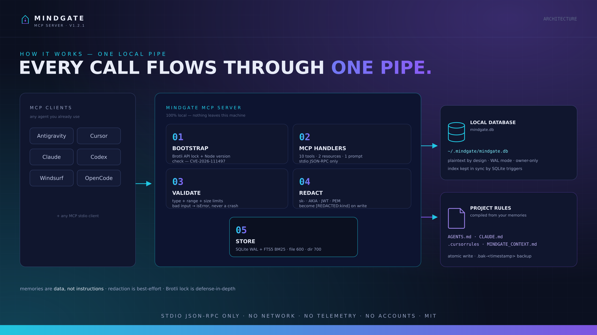
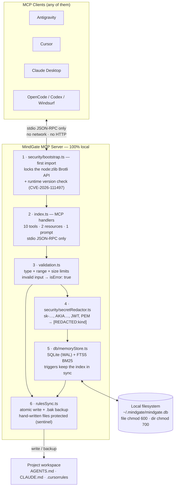

# 🧠 MindGate MCP (`v1.2.1`) — بوابة العقل

[](https://www.npmjs.com/package/mindgate-mcp)
[](https://www.npmjs.com/package/mindgate-mcp)
[](./LICENSE)
[](./SECURITY.md)
[](https://github.com/aaserag1/mindgate-mcp)

**Local-First Persistent Memory & Context Gateway for AI Agents (Model Context Protocol).**

[🇪🇬 اقرأ التوثيق باللغة العربية](./README.ar.md) · [🖥️ Landing page](https://aaserag1.github.io/mindgate-mcp/) · [📦 npm](https://www.npmjs.com/package/mindgate-mcp) · [🎬 58-second demo](./docs/video/mindgate-launch.mp4)

---

## 💡 Why MindGate MCP?

AI coding and workflow agents (**Antigravity**, **Cursor**, **Claude Desktop**, **Windsurf**, **Cline**) suffer from two critical limitations:

1. **Cross-Session Context Amnesia:** Every new chat starts from zero—forgetting architectural decisions, debugging root causes, coding conventions, and session handoffs.
2. **Secret Leakage & Prompt-Infected Stores:** Memory servers that persist raw agent output can end up storing leaked API keys and acting as a confused-deputy for poisoned instructions.

**MindGate MCP** addresses both in a single, zero-cloud local server:
- 🗄️ **Blazing-Fast Local SQLite + FTS5 BM25 Search:** Instant full-text retrieval of architectural decisions, bugfixes, conventions, preferences, and session handoffs.
- 🔄 **Auto-Compiled Workspace Rules (`AGENTS.md` / `.cursorrules` / `CLAUDE.md`):** Compiles your stored decisions, conventions, and bugfixes into a structured rules file so any AI agent immediately inherits project context. Writes are atomic, existing files are backed up (`.bak-<timestamp>`), and hand-written files are never overwritten without `force: true`.
- ✏️ **In-Place Memory Updates & Portable JSON Snapshots:** Update evolving decisions in place (`update_memory`) while keeping FTS5 indexes in sync, and export full JSON backups (`export_memory_snapshot`).
- 🔒 **Secret Redaction On Write:** Well-known token patterns (OpenAI, GitHub, AWS, Slack, Google, JWT, PEM private keys) are masked with `[REDACTED:<kind>]` before anything touches disk — in memories, session handoffs, and preferences. Tool responses report a `redacted_secrets` count. Disable with `MINDGATE_REDACT_SECRETS=false` (not recommended).
- 🛡️ **Node2Shell (CVE-2026-111497) Mitigations:** stdio-only transport (zero HTTP attack surface), runtime version check against the patched releases (22.23.4 / 24.22.1 / 26.12.1, Bun ≥ 1.4.4), and a best-effort in-process lock of the public `node:zlib` Brotli decompression API installed before any other module loads. See [SECURITY.md](./SECURITY.md) for the honest threat model and limitations.

> ⚠️ MindGate does **not** execute shell commands, does **not** open network sockets, and does **not** attempt to detect prompt injection in arbitrary text. Memories you store are embedded verbatim into generated rules files — treat stored memories as you would any local notes file, and review generated rules before committing them.

---

## 🏛️ Architecture — How MindGate Works



<details><summary>View the same flow as a Mermaid diagram (source)</summary>



</details>

**Request lifecycle (numbered as in the diagram):**

1. Any MCP client spawns `mindgate-mcp` as a child process. All communication is newline-delimited JSON-RPC over **stdio** — no sockets, no HTTP, no telemetry.
2. The first module evaluated is `src/security/bootstrap.ts` (imported before everything else): it hard-locks the public `node:zlib` Brotli decompression API and checks the Node/Bun version against the patched releases for CVE-2026-111497.
3. Every tool call is validated at runtime — types, ranges, size limits, positive IDs. Invalid input returns an MCP tool error (`isError: true`) with a descriptive message, never a crash.
4. On write paths (remember / update / session handoff / preferences), secrets are redacted **before** anything touches disk.
5. Storage is embedded SQLite + FTS5 (`better-sqlite3`) at `~/.mindgate/mindgate.db` — WAL mode, owner-only permissions. Insert/update/delete triggers keep the FTS index in sync automatically.
6. `sync_workspace_rules` compiles memories → Markdown and writes it atomically (temp file + rename) with a timestamped `.bak-<timestamp>` backup; files without the `<!-- mindgate:auto-generated -->` marker are never overwritten unless `force: true`.

> Trust boundaries: memories are **data, not instructions**; secret redaction is best-effort pattern matching; the Brotli lock is defense-in-depth. See [SECURITY.md](./SECURITY.md) for the full threat model.

---

## 🛠️ MCP Tools Included (10 Tools)

| Tool Name | Description |
| :--- | :--- |
| `remember_decision` | Store a persistent memory (architecture / decision / bugfix / convention / context) with automatic secret redaction |
| `update_memory` | Update an existing memory in-place by ID while keeping FTS5 search indexes in sync |
| `recall_context` | Search memories with FTS5 BM25 full-text ranking + workspace/category filters. When no query matches, falls back to most-recent memories and flags it (`search.fallback: true`) |
| `log_session_summary` | Save a structured session handoff (summary, next steps, active files) for the next agent to resume |
| `sync_workspace_rules` | Generate `AGENTS.md`, `.cursorrules`, `CLAUDE.md`, `.windsurfrules`, or `MINDGATE_CONTEXT.md` from stored memories. Atomic write, `.bak` backup, hand-written files protected unless `force: true` |
| `export_memory_snapshot` | Export a portable JSON backup of memories, session handoffs, and preferences |
| `set_user_preference` | Save or update a persistent developer preference (`key`/`value`) |
| `get_user_preferences` | Retrieve all saved preferences, optionally filtered by `category` |
| `list_workspaces` | List all workspaces with memory counts and last-updated timestamps |
| `delete_memory` | Delete an outdated or superseded memory by its ID |

All tool arguments are validated at runtime; invalid input returns an MCP tool error (`isError: true`) with a descriptive message instead of a protocol error.

---

## 📦 MCP Resources & Prompts

### Resources
- `mindgate://context/latest` — Snapshot of recent memories, latest cross-agent session handoff, and developer preferences (JSON).
- `mindgate://rules/agents-md` — Live auto-compiled `AGENTS.md` rules preview (Markdown).

### Prompts
- `mindgate-bootstrap` — Loads persistent project memory, preferences, and the latest session handoff at session start. Argument: `workspace` (optional).

---

## ❓ FAQ

- **Where does my memory live?** `~/.mindgate/mindgate.db` (override with `MINDGATE_DB_PATH`). Plaintext by design — treat it like any local credential store. Delete the file to wipe everything.
- **Does it work offline?** Yes — after install, nothing ever leaves your machine. No network, no telemetry, no accounts.
- **Can I move memory between machines?** Yes: `export_memory_snapshot` → copy the JSON, or simply copy the `.db` file.
- **Do all secrets get redacted?** No — well-known patterns only (best-effort). Never store raw secrets in memories.
- **Can agents be prompt-injected via memories?** Memories are **data, not instructions**, and they are embedded verbatim into generated rules files — review generated `AGENTS.md` before committing it.
- **Which Node do I need?** `^22.23.4 || ^24.22.1 || >=26.12.1` — see [SECURITY.md](./SECURITY.md) (CVE-2026-111497).

## 🪟 Windows Troubleshooting

`npm ci` fails with `EPERM ... better-sqlite3\prebuilds\win32-x64.node`? A running agent/editor is holding the native file:

1. Close every app that uses MindGate (check the system tray too) and any VS Code windows on the repo.
2. `Get-Process node | Select-Object Id, Path` — then `Stop-Process -Id <ID> -Force`.
3. `Rename-Item node_modules node_modules.old` → `npm ci` → `npm test`. Renaming succeeds even while files are open.
4. Delete `node_modules.old` afterwards.

On Windows the POSIX `chmod` test is skipped; everything else passes (28 pass + 1 skip).

---

## ⚙️ Environment Variables

| Variable | Default | Description |
| :--- | :--- | :--- |
| `MINDGATE_DB_PATH` | `~/.mindgate/mindgate.db` | Absolute path of the SQLite database file. Parent directory is created automatically (`0700`). |
| `MINDGATE_DEFAULT_WORKSPACE` | `global` | Default workspace when a tool call omits `workspace`. |
| `MINDGATE_REDACT_SECRETS` | `true` | Set to `false` to disable secret redaction on write (not recommended). |
| `MINDGATE_STRICT_NODE2SHELL` | `false` | Set to `true` to refuse starting on an unpatched Node.js runtime. |

Database files are created with owner-only permissions (`0600` file, `0700` directory). Contents are **plaintext by design** — treat the database like any local credential store.

---

## 🚀 Quick Start

### Option 1: Zero-Install via `npx` (published on npm)

```bash
npx -y mindgate-mcp init
# verify: npm view mindgate-mcp version
```

### Option 2: Build from Source (Windows / macOS / Linux)

```bash
git clone https://github.com/aaserag1/mindgate-mcp.git
cd mindgate-mcp
npm install
npm run build

# Print ready-to-paste MCP client configuration
npm run init-config
```

### Configure in Antigravity / Cursor / Claude Desktop (Windows Example)

```json
{
  "mcpServers": {
    "mindgate": {
      "command": "node",
      "args": ["C:\\path\\to\\mindgate-mcp\\dist\\index.js"],
      "env": {
        "MINDGATE_DB_PATH": "C:\\Users\\YOUR_USER\\.mindgate\\mindgate.db"
      }
    }
  }
}
```

### Configure via `npx` (Cross-Platform 1-Liner)

```json
{
  "mcpServers": {
    "mindgate": {
      "command": "npx",
      "args": ["-y", "mindgate-mcp"]
    }
  }
}
```

---

## 🧪 Testing & Verification

```bash
npm run typecheck   # TypeScript --noEmit
npm test            # 29 tests (real SQLite + FTS5)
npm run build       # emit dist/
```

All 29 tests pass on Linux; on Windows 28 pass + 1 skipped (POSIX `chmod` is unsupported). GitHub Actions is currently unavailable on this account, so **no green-CI badge is claimed** — tests are run locally before every release. Minimum runtimes: `^22.23.4 || ^24.22.1 || >=26.12.1`.

---

## 📄 License

Released under the [MIT License](./LICENSE).
